# KI: Klein gegen Groß – Das unglaubliche Duell

*German Language*

* 🎙 DEVK Meetup: KI: Klein gegen Groß – LLM vs. spezialisierte KI, wer gewinnt das Duell?
* 📅 Datum: Donnerstag, 17. September 2026
* 📍 Ort: DEVK / HDI Cafeteria, Charles-de-Gaulle-Platz 1, 50679 Köln
* 🕖 Uhrzeit: 18:00 Uhr
* 👥 57 Teilnehmende
* 🎤 Eröffnung: Manuela Moog, Vorständin IT DEVK
* 🤝 Organisation: Agnes Reipen & Lofi Dewanto

👉 [Einladung auf LinkedIn](https://www.linkedin.com/feed/update/urn:li:activity:7500164088879030273)

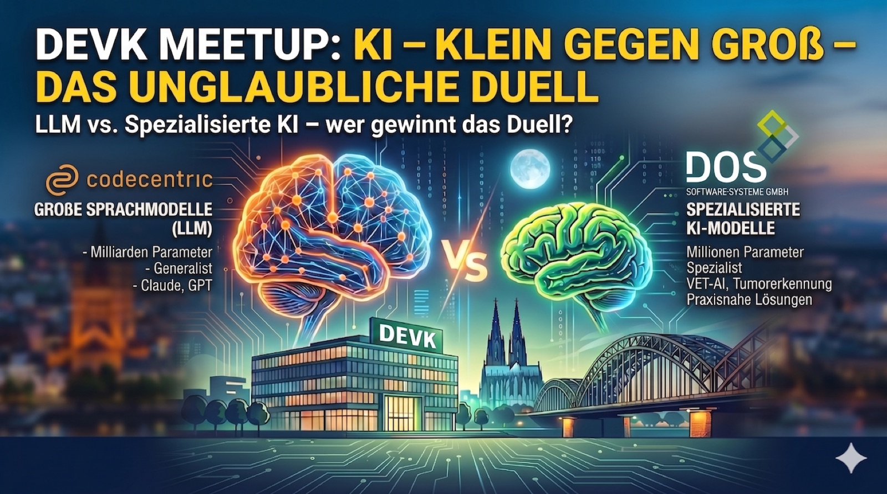

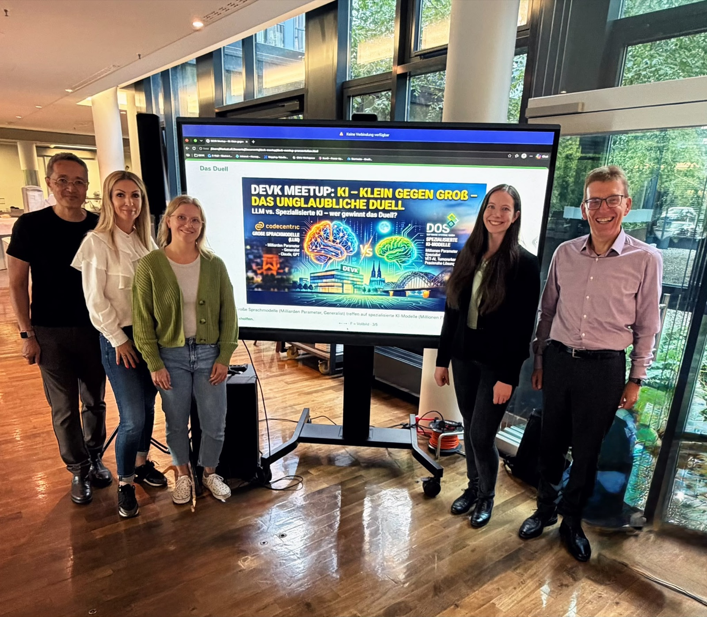

Braucht jedes Problem ein Modell mit Milliarden Parametern – oder reicht manchmal ein kleiner Spezialist? Auf der einen Seite die Generalisten: stark in Sprache, Kontextverständnis und Reasoning. Auf der anderen Seite die Spezialisten: in klar abgegrenzten Domänen oft effizienter, günstiger, präziser und besser steuerbar.

Die Meetup-Reihe ist längst eine kleine Tradition: 2019 hieß es „GWT vs. VueJS“, kurz danach „Bright Side vs. Dark Side of Microservices“, 2025 dann „KI – Fluch oder Segen?“. In diesem Jahr ging es nicht mehr um die Frage, ob KI hilft, sondern welche KI zu welchem Problem passt.

> „Entscheidend ist nicht, welches Modell am beeindruckendsten klingt, sondern welches unser Problem am besten löst.“

<table>
<tr>
<td>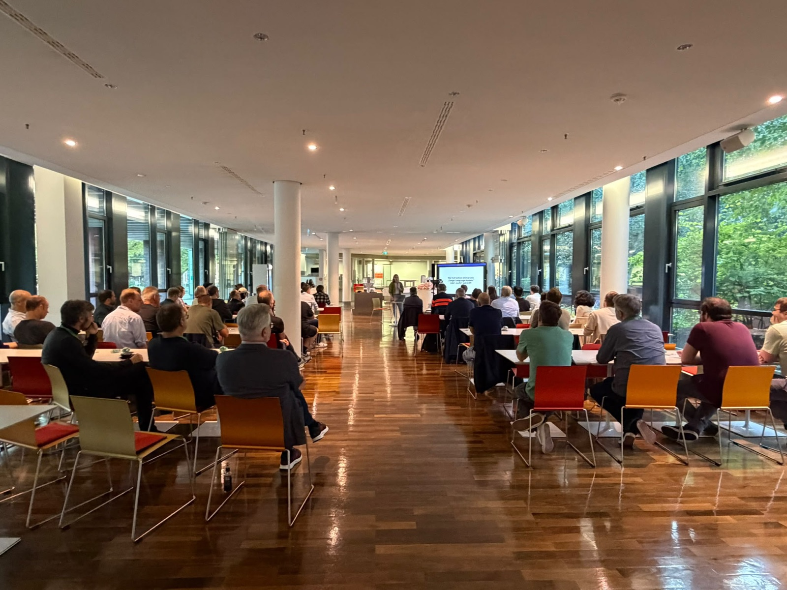 <em>57 Gäste in der Cafeteria am Charles-de-Gaulle-Platz.</em></td>
<td>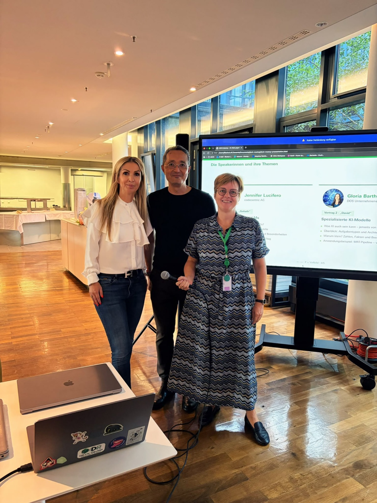 <em>Begrüßung und Moderation.</em></td>
</tr>
</table>

📰 Rückblick (IT News): [Webseite](https://devk-insurance.github.io/devk-meetups/ki-klein-vs-gross/) · [PDF](https://github.com/devk-insurance/devk-meetups/blob/master/ki-klein-vs-gross/2026-09-17-devk-meetup-ki-klein-vs-gross-it-news.pdf)

## Groß – „Goliath“

🚀 Jennifer Lucifero
„GenAI & große LLMs – Was große Sprachmodelle so besonders macht“

Große Sprachmodelle wie GPT und Claude sind in aller Munde – aber was steckt eigentlich dahinter? Jennifer zeigt, wie ein LLM grundsätzlich funktioniert (Tokenization, Embeddings, Self-Attention, Softmax), warum Milliarden von Parametern einen Unterschied machen und welche Modelle aktuell den Markt prägen. Kernbotschaft:

> „Ein LLM weiß nichts – es schätzt nur verdammt gut.“ – Jennifer Lucifero, „Die Illusion der Intelligenz“

<table>
<tr>
<td>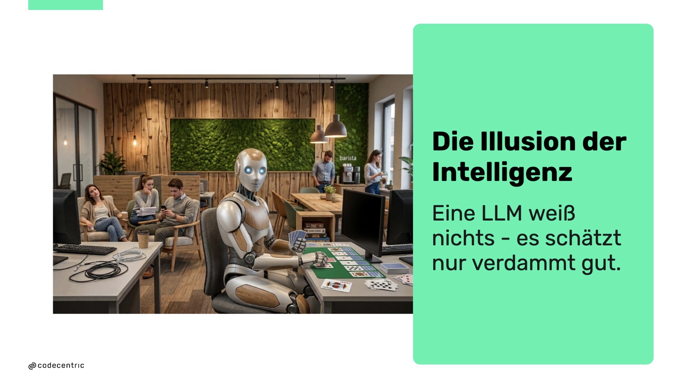 <em>Die Illusion der Intelligenz</em></td>
<td>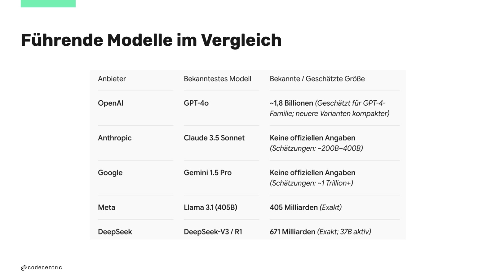 <em>„Groß“ heißt: hunderte Milliarden bis Billionen Parameter.</em></td>
</tr>
</table>

Ein Schwerpunkt war **Context Engineering**: Moderne Modelle bieten Kontextfenster von rund einer Million Tokens, aber mehr ist nicht automatisch besser – mit wachsendem Kontext sinkt die Trefferqualität deutlich. Ziel ist, in der „Smart Zone“ statt in der „Dumb Zone“ des Kontextfensters zu arbeiten.

<table>
<tr>
<td>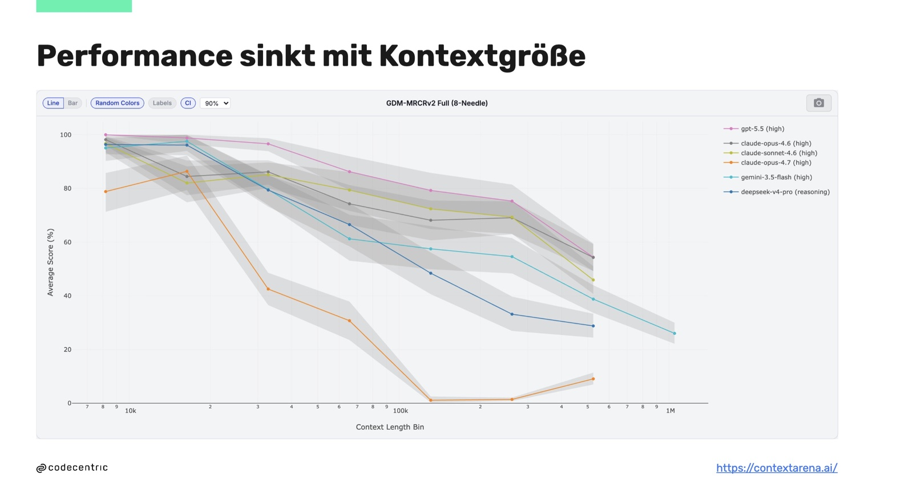 <em>Performance sinkt mit der Kontextgröße.</em></td>
<td>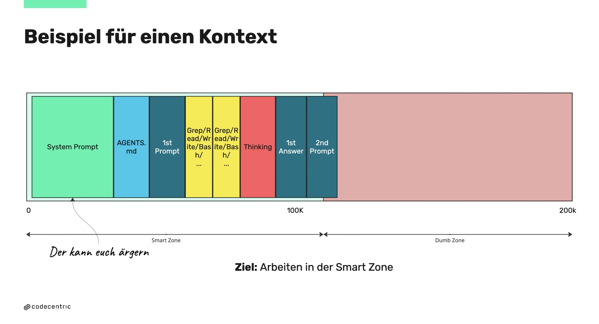 <em>Ziel: in der Smart Zone arbeiten.</em></td>
</tr>
</table>

Praxistipps für das Context Management:

* Dauerhaft gültige Regeln in Dateien auslagern (z. B. `AGENTS.md`)
* Bei Themenwechsel eine neue Session starten
* Antwortlänge begrenzen: „antworte kurz und prägnant“
* Den bisherigen Stand komprimieren
* Nur wenn es nicht anders geht: Modelle mit großem Kontextfenster wählen

Bei der Modellwahl helfen drei Kriterien: **Preis pro Token**, **Größe des Kontextfensters** und **Inferenzgeschwindigkeit**. Es lohnt sich außerdem, gezielt quelloffene, lokal laufende oder europäische Modelle auszuprobieren.

Praxisbeispiele: Der **Renovate Fixer** reagiert automatisch auf fehlgeschlagene Dependency-Updates in GitLab: Ein Main-Agent liest Pipeline-Logs, repariert Lock-Files und pusht einen Fix-Commit; ein Research-Agent sammelt Informationen zu Major-Updates (gebaut mit Pydantic AI und MCP-Toolsets). **SmartClaim AI** ist eine Demo für KI-gestützte Schadenbearbeitung bei Versicherungen – jeder Schritt läuft über Mistral AI, die App selbst wurde in rund neun Stunden hauptsächlich von Claude Sonnet gebaut.

<table>
<tr>
<td>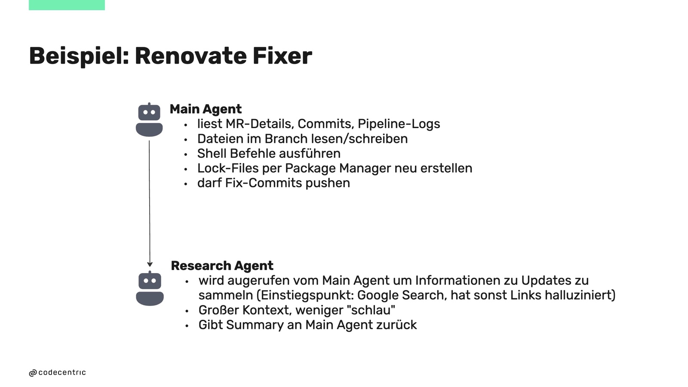 <em>Renovate Fixer: Main-Agent plus Research-Agent.</em></td>
<td>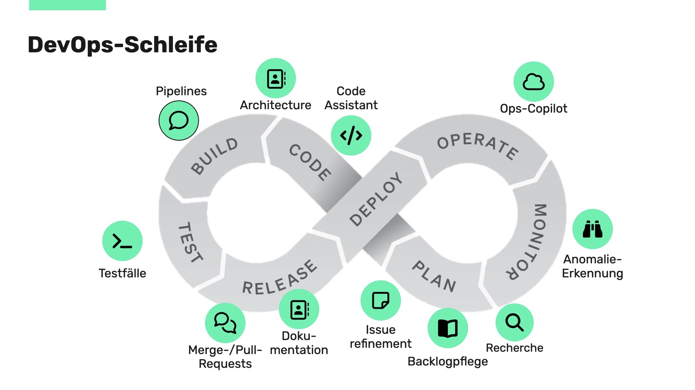 <em>KI-Einsatz entlang der gesamten DevOps-Schleife.</em></td>
</tr>
</table>

Über Jennifer:
Jennifer arbeitet als IT-Consultant bei der codecentric AG in Solingen und beschäftigt sich mit Automatisierung und dem Einsatz von KI im Berufsalltag. Sie nutzt die „Goliaths“ unter den Sprachmodellen inzwischen ganz selbstverständlich im Alltag – so sehr, dass klassisches Coding immer mehr in den Hintergrund rückt.

Presentation: [2026-09-17-devk-meetup-ki-gross-llms.pdf](https://github.com/devk-insurance/devk-meetups/blob/master/ki-klein-vs-gross/2026-09-17-devk-meetup-ki-gross-llms.pdf)

## Klein – „David“

💡 Gloria Barth
„Spezialisierte KI-Modelle – Warum manchmal viele kleine Modelle mehr können als ein großes“

<table>
<tr>
<td>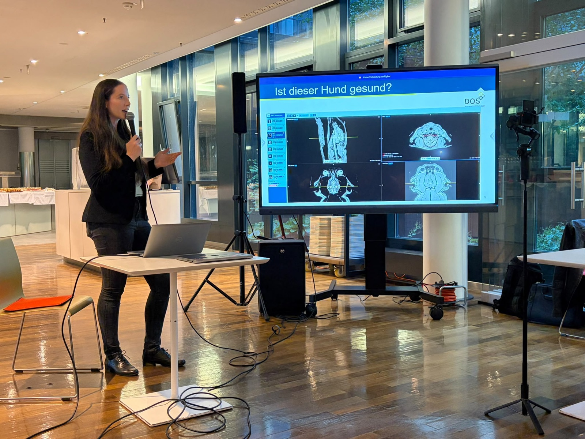 <em>Gloria Barth: „Ist dieser Hund gesund?“</em></td>
<td>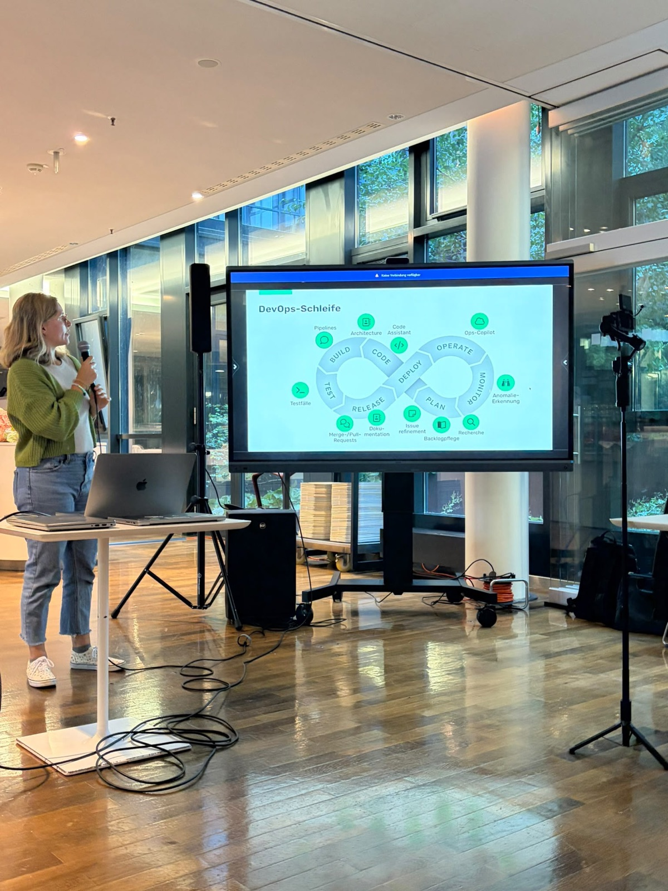 <em>Jennifer Lucifero mit der DevOps-Schleife.</em></td>
</tr>
</table>

Gloria erinnerte daran, dass Sprachmodelle nur die Spitze des Eisbergs sind. Unter der Oberfläche laufen seit Jahren medizinische Bildanalyse, Betrugserkennung, Predictive Maintenance und Empfehlungssysteme. Dazu passt das Tesler-Theorem: „Intelligenz ist das, was Maschinen noch nicht getan haben.“

Ihr Praxisbeispiel trug den Titel **„Ist dieser Hund gesund?“**: Für das Produkt TomoSense hat DOS eine MRT-Diagnose-Pipeline für Hunde gebaut. Statt eines Universalmodells gibt es vier Aufgaben mit vier Architekturen:

Stufe | Frage | Modell
-------- | -------- | --------
1 · Segmentierung | Wo ist das Gehirn? | 3D nnU-Net
2 · Klassifikation | Was ist auf dieser Schicht? (5 Symptome) | CNN „SepNetDense“, nur 76.626 Parameter
3 · Signalanalyse | Wie wahrscheinlich hat der Patient ein Symptom? | Wavelet-Transformation + XGBoost-Regressor
4 · Entscheidung | Tumor, Entzündung oder unauffällig? | XGBoost-Klassifikator

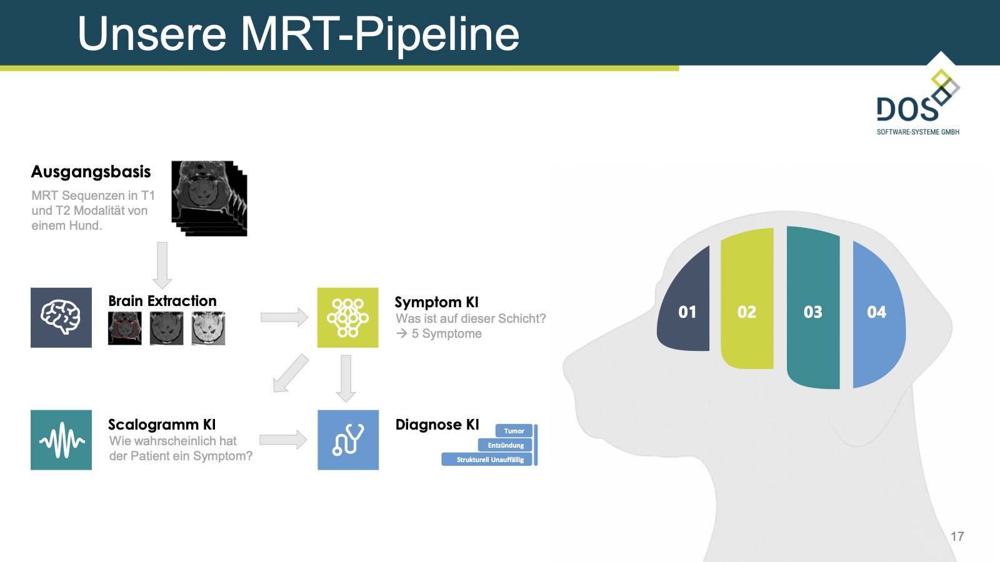

*Vom MRT-Bild zur Diagnose in vier spezialisierten Stufen.*

Klein in Zahlen:

* **31,3 Mio.** Parameter gesamt (statt ~1,8 Billionen)
* **1 GPU**, 2 Wochen reines Training
* **94,4 %** Genauigkeit: unauffällig vs. abnormal
* **86,0 %** Genauigkeit: drei Diagnoseklassen

Besonders anschaulich war das Beispiel zum **Scanner Bias**: Auf bekannten MRT-Scannern erreichte die Segmentierung eine IoU von 0,88, auf fremden Geräten brach sie auf 0,31 ein. Nach dem Muster Messen – Diagnostizieren – Reparieren – Nachmessen lagen danach beide Werte bei rund 0,90. Genau diese Messbarkeit ist die große Stärke des Spezialwegs – dazu die Reproduzierbarkeit: gleiches Bild rein, gleicher Score raus, ohne Sampling und ohne Temperatur.

<table>
<tr>
<td>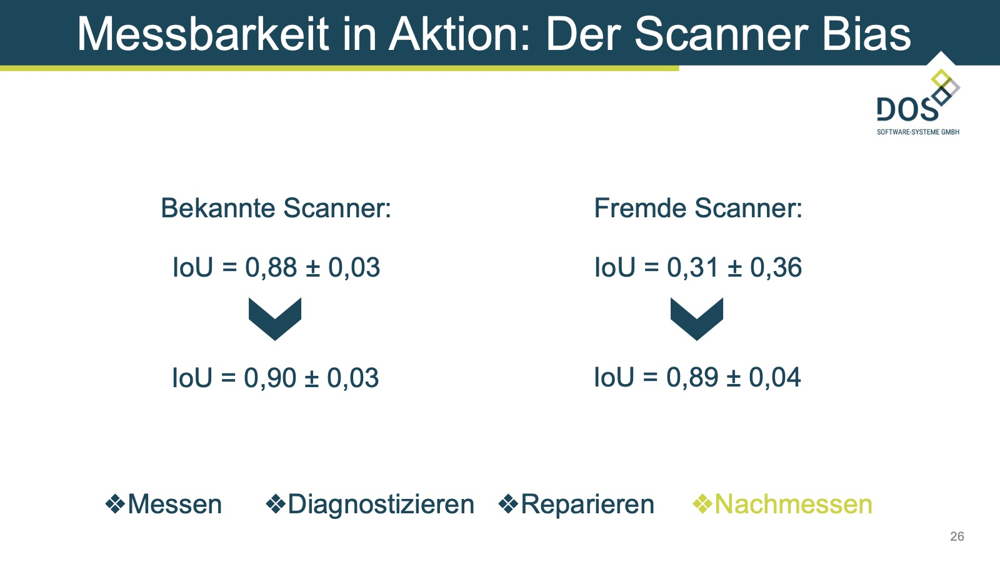 <em>Messbarkeit in Aktion: Scanner Bias erkannt und behoben.</em></td>
<td>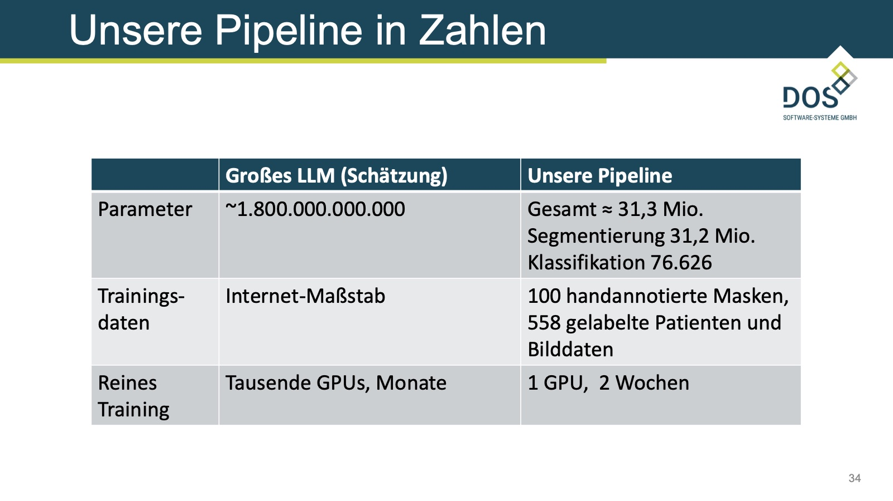 <em>Klein gegen Groß in Zahlen.</em></td>
</tr>
</table>

Der Spezialweg hat aber auch seinen Preis: Annotierte Daten sind der Engpass, Domänenwissen ist Pflicht, und jedes Modell muss einzeln trainiert, validiert, versioniert und überwacht werden. Ein kompletter Patient braucht im Schnitt fünf Minuten – das neuronale Netz selbst rechnet davon nur Millisekunden.

Über Gloria:
Gloria arbeitet als Data Scientist bei der DOS Software-Systeme GmbH. Sie mag es, sich in neue Fachbereiche einzuarbeiten und spezifische Probleme mit passgenauer KI zu lösen – auch wenn ein Modell nie wirklich fertig ist, denn neue Erkenntnisse aus der Domäne eröffnen regelmäßig weitere Lösungswege.

Presentation: [2026-09-17-devk-meetup-ki-klein-spezialisierte-modelle.pdf](https://github.com/devk-insurance/devk-meetups/blob/master/ki-klein-vs-gross/2026-09-17-devk-meetup-ki-klein-spezialisierte-modelle.pdf)

## Fazit – Kein Entweder-oder, sondern die Passung

Am Ende gab es keinen K.-o.-Sieg. Beide Vorträge kamen zu derselben Schlussfolgerung:

> „Wo es richtig und falsch gibt und der Output eine Maske, ein Score, eine Klasse ist, baut man das Werkzeug. Wo es um Sprache und Kontext geht, nimmt man das große Modell. Warum nicht beides?“ – Gloria Barth, DOS Software-Systeme GmbH

Der Spezialist gehört in den Kern, das Sprachmodell an den Rand: Es kann Befundtexte einlesen, Ergebnisse formulieren und Randfälle für das weitere Training priorisieren. Jennifer gab mit dem Ausblick die Richtung vor: vom Chatbot zum Agenten. Beim anschließenden Buffet wurde noch lange weiterdiskutiert, ob Goliath oder David die Nase vorn hat.

<table>
<tr>
<td>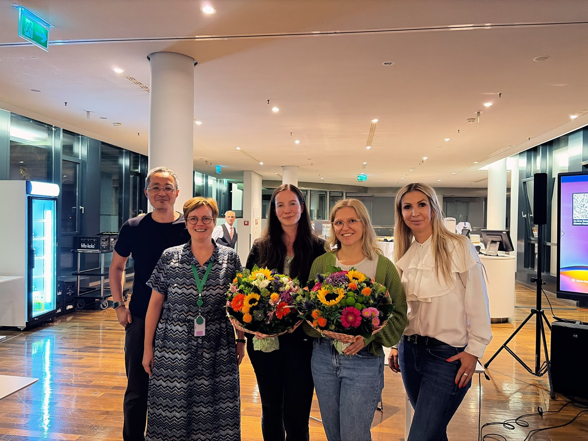 <em>Blumen für die Speakerinnen zum Abschluss.</em></td>
<td>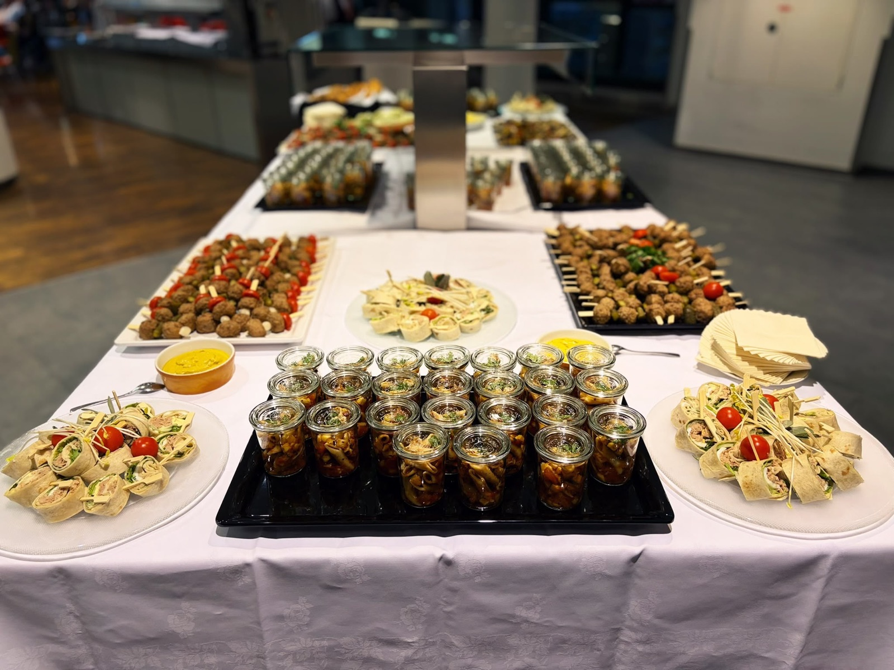 <em>Networking mit Fingerfood: der inoffizielle dritte Programmpunkt.</em></td>
</tr>
</table>

Ein herzliches Dankeschön an Manuela Moog für die Eröffnung, an Jennifer Lucifero, Gloria Barth und Jörg Janisch (DOS), an codecentric AG und DOS Software-Systeme GmbH sowie an alle, die den Abend möglich gemacht haben.

## Zum Nachschauen – Ausgewählte Folien

<table>
<tr>
<td>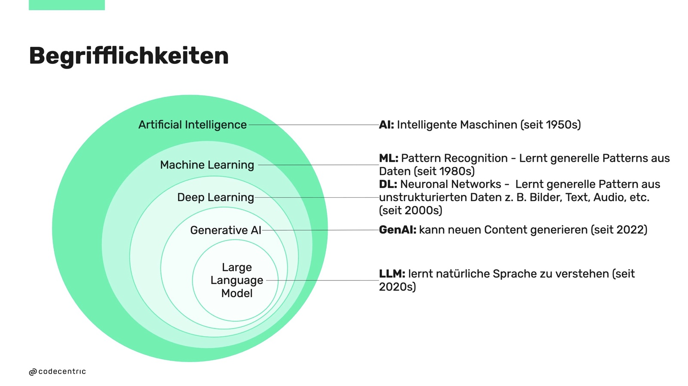 <em>Begrifflichkeiten: AI ⊃ ML ⊃ DL ⊃ GenAI ⊃ LLM</em></td>
<td>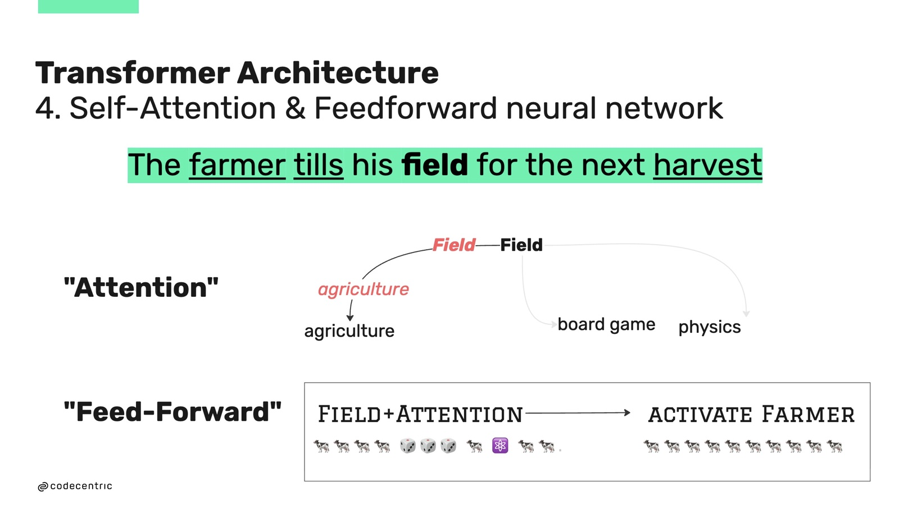 <em>Self-Attention am Beispiel „field“</em></td>
<td>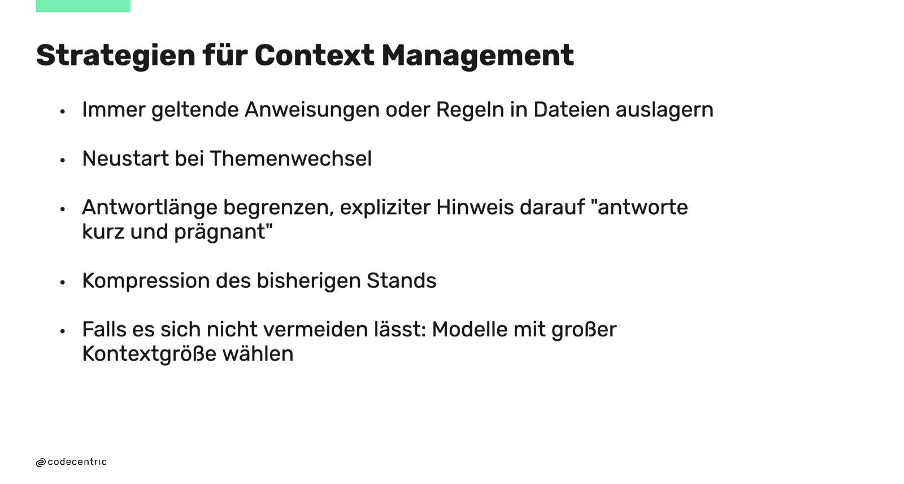 <em>Strategien für Context Management</em></td>
</tr>
<tr>
<td>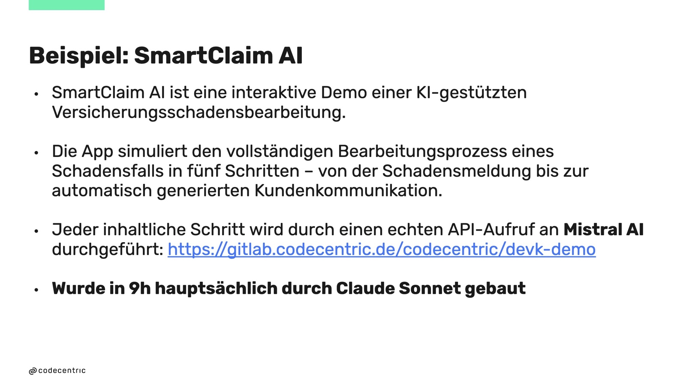 <em>SmartClaim AI: in 9 h mit Claude gebaut</em></td>
<td>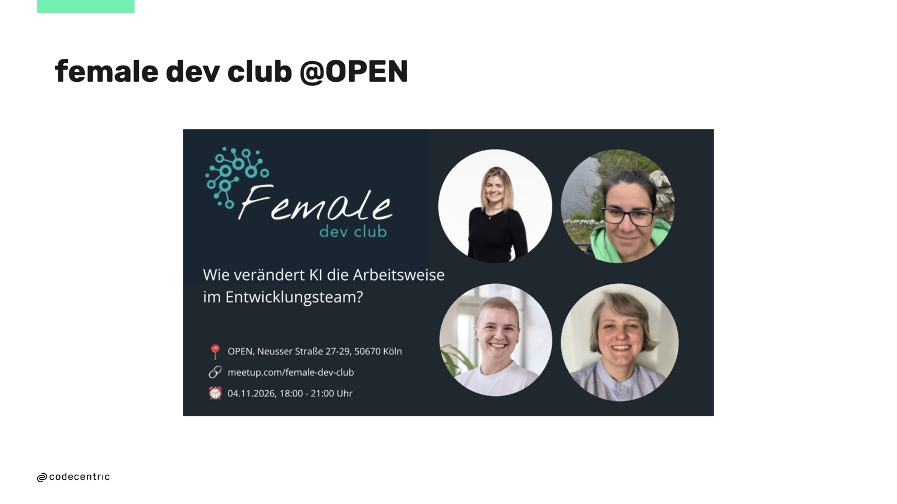 <em>female dev club @OPEN: „Wie verändert KI die Arbeitsweise im Entwicklungsteam?“</em></td>
<td>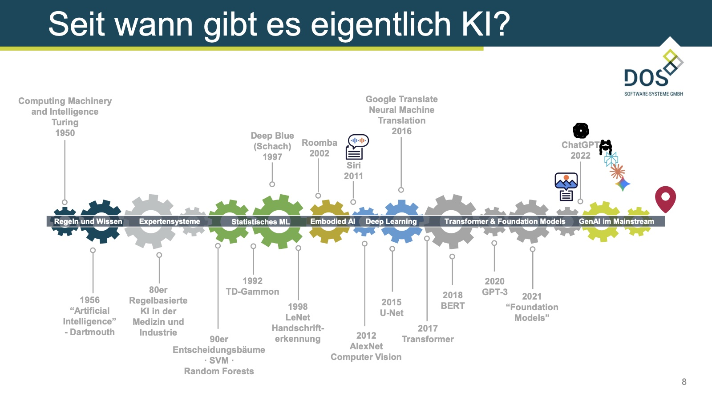 <em>Seit wann gibt es eigentlich KI?</em></td>
</tr>
<tr>
<td>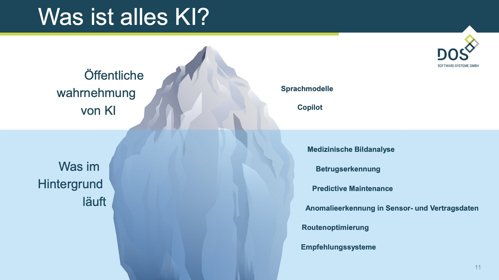 <em>Der KI-Eisberg</em></td>
<td>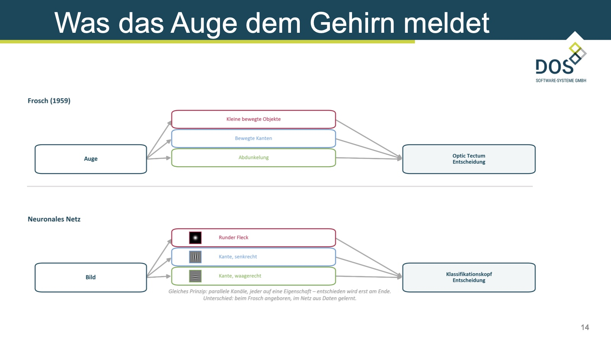 <em>Froschauge und neuronales Netz</em></td>
<td>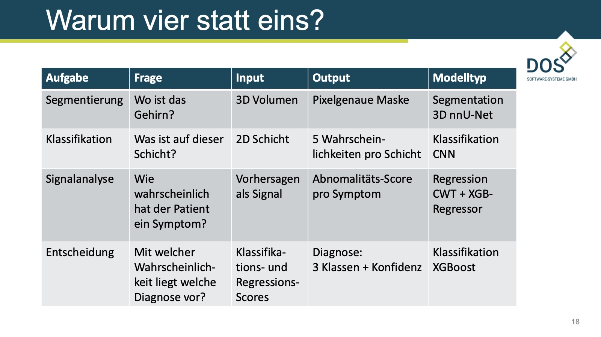 <em>Warum vier Modelle statt eins?</em></td>
</tr>
<tr>
<td>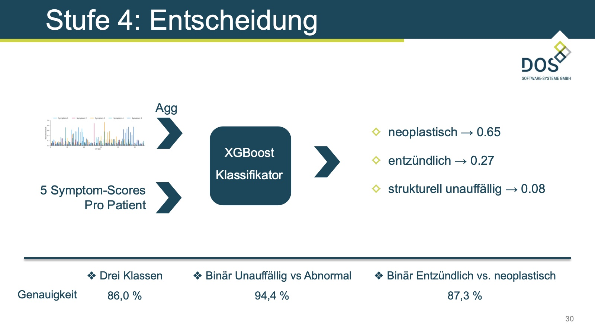 <em>Stufe 4: die Entscheidung</em></td>
<td>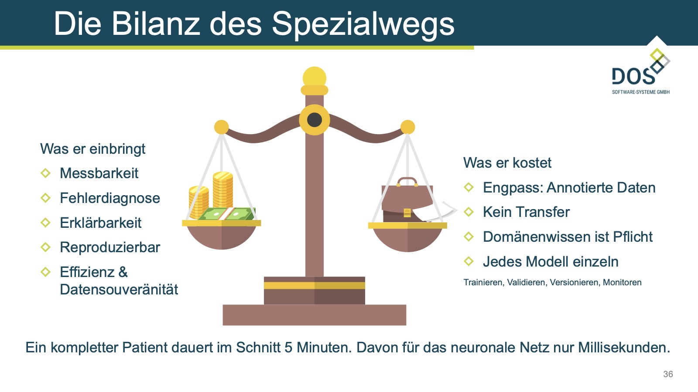 <em>Die Bilanz des Spezialwegs</em></td>
<td>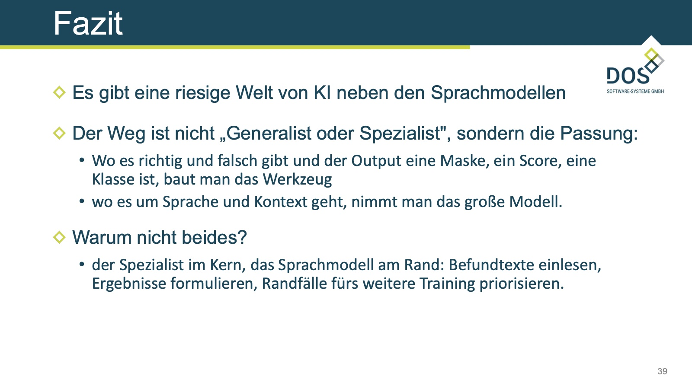 <em>Fazit: Passung statt Entweder-oder</em></td>
</tr>
<tr>
<td colspan="3">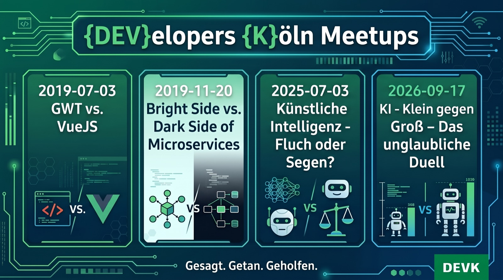 <em>{DEV}elopers {K}öln: Meetups seit 2019</em></td>
</tr>
</table>

*Fotos: Event-Team · Folien: codecentric AG, DOS Software-Systeme GmbH*
